

<a href="https://x.com/ithakur__"></a>

<a href="https://github.com/Ithakur2327/FlowForgeAI"></a>
<a href="https://github.com/Ithakur2327/QueryPilot"></a>
<a href="https://github.com/Ithakur2327/I.Vision"></a>
<a href="https://github.com/Ithakur2327/HealthnexAI"></a>
<a href="https://github.com/Ithakur2327/SnipixAI"></a>
<a href="https://github.com/Ithakur2327?tab=repositories"></a>
<a href="https://leetcode.com/IThakur09"></a>

<a href="https://github.com/Ithakur2327"></a>

