

&nbsp;&nbsp;&nbsp;&nbsp;&nbsp;&nbsp;&nbsp;&nbsp;
<picture><source media="(prefers-color-scheme: dark)" srcset="assets/focus-00a-d.svg"/></picture>
<picture><source media="(prefers-color-scheme: dark)" srcset="assets/built-00a-d.svg"/></picture>
<a href="https://github.com/Ithakur2327/FlowForgeAI"></a>
<a href="https://github.com/Ithakur2327/I.Vision"></a>
<a href="https://github.com/Ithakur2327/HealthnexAI"></a>

<picture><source media="(prefers-color-scheme: dark)" srcset="assets/tools-00a-d.svg"/></picture>
<picture><source media="(prefers-color-scheme: dark)" srcset="assets/stats-00a-d.svg"/></picture>

<picture><source media="(prefers-color-scheme: dark)" srcset="assets/contrib-00a-d.svg"/></picture>

